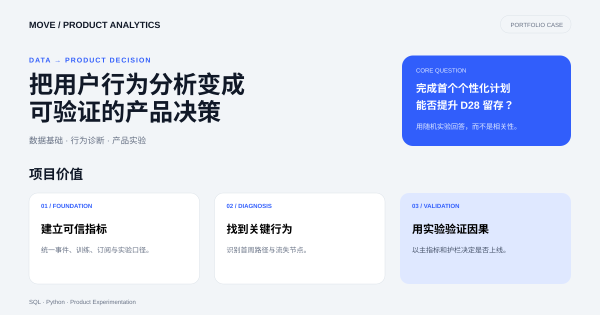

# Fitness App 用户行为分析：方法验证与实验方案

> 作品集案例｜合成数据｜SQL/Python 分析流程｜产品实验设计

## Dashboard 预览

> 点击预览图查看完整案例页面。

## 项目定位

本仓库使用脚本生成的合成数据，字段结构参考公开的健身 App 场景。仓库中的用户、留存、付费率、渠道效果和功能使用差异都不属于任何公司的真实经营结果，也不能用来判断真实用户行为。

项目展示两项能力：

1. 如何搭建可复现的数据清洗、SQL 分析、看板和用户分群流程。
2. 如何把观察结果转成需要真实数据验证的产品假设和实验设计。

## 业务问题

假设一家订阅制健身 App 希望提升新用户激活与长期留存，分析需要回答：

- 哪些首次体验行为与后续留存相关？
- AI Coach 的使用是留存原因，还是高意愿用户的结果？
- 免费用户在哪个步骤流失？
- 哪个渠道带来有贡献利润的用户，而非只带来注册或模拟付费率？

## 当前数据能与不能回答什么

| 可以展示 | 不能证明 |
|---|---|
| 数据模型、清洗流程、SQL、可视化与分群方法 | 真实 DAU、留存率或付费率 |
| 指标定义和分析路径 | AI Coach 导致完成率提升 |
| 如何发现相关性并形成假设 | Influencer 渠道应获得更多预算 |
| 如何设计实验与监控 | 某项功能一定提升 5%–10% 留存 |

仓库现有“3,000 用户”“D7 81.4%”“D30 57.6%”“AI Coach 使用者完成率更高”等数字均来自合成规则。它们是管道测试结果，不是业务成绩。

## 建议的真实业务结论路径

优先验证“新用户首次 7 天内完成个性化计划，是否提升 D28 留存”。先做观察性分析控制注册渠道、国家、训练经验和初始意愿，再通过随机实验验证因果关系。

- **对照组**：现有新手流程。
- **实验组**：更容易发现的 AI Coach 入口 + 一次引导式计划创建。
- **主指标**：D28 留存或第 4 周有效训练人数。
- **护栏指标**：退款、通知关闭、跳出、支持工单。
- **诊断指标**：计划创建率、首次训练完成率、首周训练天数。
- **分析单位**：新注册用户；按预先定义的实验窗口与归因规则统计。

详细说明见 [真实数据验证与实验方案](product/真实数据验证与实验方案.md)。

## 项目结构

- scripts/generate_dataset.py：合成数据生成逻辑，可审查假设
- scripts/data_cleaning_analysis.py：清洗与指标计算
- sql/business_analysis.sql：业务查询示例
- notebooks/：分析流程
- dashboard/：**合成数据演示看板**
- product/ai_coach_prototype.html：产品交互原型
- product/AI_Coach_产品策划方案.md：基于假设的方案草案
- [真实数据验证与实验方案](product/真实数据验证与实验方案.md)：数据接入、偏差控制和 A/B 测试

## 需要接入的真实数据

最低需要用户注册与渠道归因、事件日志、训练计划与完成记录、订阅和退款、实验分组，以及国家/设备等非敏感上下文。每个事件应有稳定的 user_id、UTC 时间、事件版本和来源。

## 使用方法

运行 scripts/generate_dataset.py 和 scripts/data_cleaning_analysis.py。运行结果用于验证代码和看板是否工作。若接入真实数据，应先替换数据字典与合成数据入口，再运行质量检查、指标计算和实验分析。

## 数据伦理与限制

该数据不包含真实个人数据。所有相关性、细分市场差异和渠道表现都由生成规则影响；行业基准也不能替代公司自身基线。产品决策必须在真实数据、用户研究和受控实验上重新验证。
